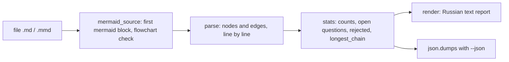

# claude-code-mind-viz — documentation

`mmdstats` is a console tool that reads a decision graph written as a Mermaid flowchart and prints its statistics: node and edge counts, nodes of each kind (question, hypothesis, check, decision) by status, open questions, rejected nodes, and the longest chain through nodes that were not rejected (`README.md`, `src/mmdstats.py:1-18`). The graph is the one a Claude Code session keeps in `.claude/decision_graph/current_task.md` while working on a long task (`README.md`, `CLAUDE.md`, section "The decision graph"). Who uses the tool besides the repository owner is not stated in the repository.

The requirements specification is [`../SPEC.md`](../SPEC.md).

## Status

- Last commit touching the tool's own code (`src/`, `test_mmdstats.py`): `41ccb61`, 2026-11-07 (`git log -1 -- src test_mmdstats.py`). The newest commit in the repository, `eb73f59` (2026-11-08), changes documentation only.
- Version 1.0.0 (`pyproject.toml`, `recipe.ps1:13`, `CHANGELOG.md`).
- Tests exist: 27 `unittest` cases in `test_mmdstats.py` and 2 pytest checks in `tests/test_manual_list.py`. Coverage floor 97 % (`pyproject.toml`, `[tool.pytest.ini_options]`).
- CI: Gitea workflows in `.gitea/workflows/` (part of the lab tooling; `test.yaml` runs on a `windows` runner).
- Unfinished: `README.md` lists exceptions to lab revision 4.0.0 — R-02 (#8), R-09 (#9), R-37 (#10), R-41 (#11), R-42 (#12). `CHANGELOG.md` lists issues #1–#7 as open. The manual-test list `tests/manual/tests.json` is empty.

## Layout

| Path | What it is |
| --- | --- |
| `src/mmdstats.py` | the whole tool: parser, statistics, longest chain, text/JSON output, CLI |
| `test_mmdstats.py` | unit tests of the tool; kept at the root because it reads `.claude/decision_graph/` beside it (`pyproject.toml`) |
| `.claude/decision_graph/current_task.md` | the decision graph of the task that built this tool; default input and test fixture |
| `.claude/decision_graph/trace.md`, `archive/` | older graphs written by a trace hook that this repository no longer wires up (`docs/manual.md`); also test fixtures |
| `docs/install.md` | what to install |
| `docs/manual.md` | CLI options, graph format, how to re-enable the trace hook |
| `pyproject.toml`, `uv.lock` | Python version, dev tool pins, pytest/ruff/mypy settings |
| `recipe.ps1` | the project's verbs (`build`, `run`, `test`, …) |

## Architecture

One module, standard library only (`pyproject.toml`: `dependencies = []`). Data flows through four functions in `src/mmdstats.py`:



- `mermaid_source` (`src/mmdstats.py:53`) takes the first ```` ```mermaid ```` block of a Markdown file, or the whole text of any other file, and rejects anything whose first non-comment line is not `flowchart`/`graph`.
- `parse` (`src/mmdstats.py:91`) hides quoted strings, strips edge labels, splits on arrows and `&`, and matches each part against a node pattern. Unparsed lines go to a `warn` callback (stderr in the CLI).
- A node's kind is the `Q:`/`H:`/`T:`/`A:` prefix of its label, otherwise `-` (`src/mmdstats.py:121-123`).
- `longest_chain` (`src/mmdstats.py:127`) drops rejected nodes, then uses dynamic programming over a Kahn topological order for acyclic graphs; for cyclic graphs it enumerates simple paths, and above 300 live nodes (`BRUTE_FORCE_LIMIT`) it first drops back-edges by declaration order.

No external services, network or hardware are used by the tool.

## Build and run

Prerequisites (`docs/install.md`, `pyproject.toml`):

- Python `>=3.13,<3.14`
- [uv](https://docs.astral.sh/uv/); `uv.lock` pins the dev tools: ruff 0.16.1, mypy 2.3.0, pytest 8.4.2, pytest-cov 5.0.0, coverage 7.15.2.
- PowerShell for `recipe.ps1`.

| Step | Command | Source |
| --- | --- | --- |
| install dev tools | `uv sync --frozen` | `docs/install.md` |
| run on the default graph | `.\recipe.ps1 run` | `README.md`, `recipe.ps1:60-63` |
| run on a file, JSON | `.\recipe.ps1 run path\to\graph.md --json` | `README.md` |
| run without the recipe | `python src/mmdstats.py [file] [--json]` | `src/mmdstats.py:8-9` |
| build a wheel into `dist\` | `.\recipe.ps1 build` | `docs/install.md`, `recipe.ps1:48-51` |
| run from an installed wheel | `python -m mmdstats` | `docs/install.md` |

There is no console-script entry point on purpose; `python -m mmdstats` runs the `__main__` block that switches stdout/stderr to UTF-8 (`pyproject.toml`, `src/mmdstats.py:234-238`).

## Configuration

The tool reads no environment variables and no config files. CLI (`src/mmdstats.py:218-222`, `docs/manual.md`):

| Argument | Meaning | Default |
| --- | --- | --- |
| `file` (positional, optional) | Markdown file (first `mermaid` block is read) or a whole `.mmd` file | `.claude/decision_graph/current_task.md`, relative to the current directory |
| `--json` | print JSON instead of the Russian text report | off |

## Usage

Report on this repository's own graph (run 2026-11-19 from the repository root with `python -B src/mmdstats.py`; output abridged):

```text
Узлов: 18, рёбер: 17

вопрос      5   в работе 0, принято 5, отвергнуто 0, без статуса 0
гипотеза    8   в работе 0, принято 4, отвергнуто 4, без статуса 0
...
Самая длинная цепочка (10):
  1. Q: язык и зависимости
  ...
```

With `--json` the same data comes as an object with keys `nodes`, `edges`, `by_kind`, `open_questions`, `rejected`, `longest_chain` (`src/mmdstats.py:190-197`). The graph format the tool expects is described in `docs/manual.md`, section "The graph format".

## Testing

- `.\recipe.ps1 test` checks that `recipe.ps1` `$Version` equals the `pyproject.toml` version, sets `core.hooksPath`, then runs pytest, mypy, `ruff check .` and `ruff format .` (in place) (`recipe.ps1:82-109`).
- pytest collects `tests/` and `test_mmdstats.py` with coverage on `src`, failing under 97 % (`pyproject.toml`).
- `test_mmdstats.py` covers: node/edge parsing, all node shapes and unquoted labels, arrow forms, edge-label forms, arrows inside quotes, `class` statements, keyword skipping by word boundary, unparsed lines, `;` and CRLF, missing fence / non-flowchart / unterminated fence, counts, longest chain on DAGs, with rejected nodes, with cycles, on a 2001-node chain and a 401-node cycle, CLI JSON and text output, unreadable files, and parsing of the real graphs in `.claude/decision_graph/`.
- `tests/test_manual_list.py` checks the shape of `tests/manual/tests.json` (lab tooling).

## Known limitations and problems

Derived from the code; none of these is reported as a bug in the repository.

- The report text and the error messages are in Russian only; `--json` keys are English but label values are as written in the graph (`src/mmdstats.py:200-215`).
- Only one `:::class` suffix per node definition is recognised; a line like `A:::done:::x` does not match the node pattern and is reported as unparsed (`src/mmdstats.py:40`).
- A `class A,B status` statement replaces the node's status, while in Mermaid classes accumulate (`src/mmdstats.py:98-102`). `docs/manual.md` documents that a second `X:::done` line "adds a class" in Mermaid; the tool keeps the last one.
- Statuses other than `active`/`done`/`rejected` are counted as "no status" (`src/mmdstats.py:189`).
- A node whose label does not start with `Q:`, `H:`, `T:` or `A:` (including a node never given a label) counts as "other" (`src/mmdstats.py:121-123`).
- For cyclic graphs up to 300 live nodes the longest chain is found by enumerating simple paths; the running time of this on dense graphs is not bounded or measured in the repository (inference from `src/mmdstats.py:155-163`). Above 300 nodes the result on a cyclic graph is the longest path after dropping back-edges, not necessarily the longest simple path (`src/mmdstats.py:140-143`).
- `edges` counts every parsed edge, including duplicates and edges to rejected nodes (`src/mmdstats.py:119`, `192`).
- Only the first `mermaid` block of a Markdown file is read (`src/mmdstats.py:33`, `55`).

## Repository tooling

The repository follows the lab repository standard ([repo-quality-template](https://github.com/IGORSVOLOHOVS/repo-quality-template)); `README.md` states compliance with revision 4.0.0 of the lab requirements, with exceptions R-02, R-09, R-37, R-41, R-42. Project-specific settings in `recipe.ps1`:

- `$Name = 'claude-code-mind-viz'`, `$Code = 'ccmv'`, `$Version = '1.0.0'`, `$Needs = @()`, `$Tools = @()`.
- No `$App` (no window, no installer); `$Provides = @('src')` (`recipe.ps1:18-19`).
- Verbs that do something: `build` (wheel via `uv build`), `run`, `test`, `clean` (removes `dist`, `build`, `out`, `.coverage`), `publish` (copies the wheel under `$env:LAB_SHARE\needs\<name>\v<version>`; fails without `LAB_SHARE`), `info`. `install` and `uninstall` print "nothing to install/uninstall" (`recipe.ps1:47-81`).
- Deviations stated in `CLAUDE.md`: `.claude/.env` is gitignored and never committed (reversal of R-02); `.claude/decision_graph/trace.md` is not wired to a hook here.

## Related documents

- [`../README.md`](../README.md) — project overview
- [`install.md`](install.md) — installation
- [`manual.md`](manual.md) — CLI and graph format
- [`../SPEC.md`](../SPEC.md) — requirements specification
- [`../CLAUDE.md`](../CLAUDE.md) — working rules and decision-graph rules
- [`../CHANGELOG.md`](../CHANGELOG.md), [`../CONTRIBUTING.md`](../CONTRIBUTING.md), [`../LICENSE`](../LICENSE)

## About this document

Written 2026-11-19 from commit `eb73f59` (branch `release`).

Checks run: `git ls-files`, `git log`, `PYTHONPATH=src python -B -m unittest test_mmdstats` (Python 3.13.3: 27 tests, OK), `python -B src/mmdstats.py` on the default graph (output above).
Not run: `.\recipe.ps1 test` (it runs `uv run`, which may install packages, sets git config and reformats files), pytest with coverage, mypy, ruff, `recipe.ps1 build`, `tests/manual/serve.py`, any CI workflow.
