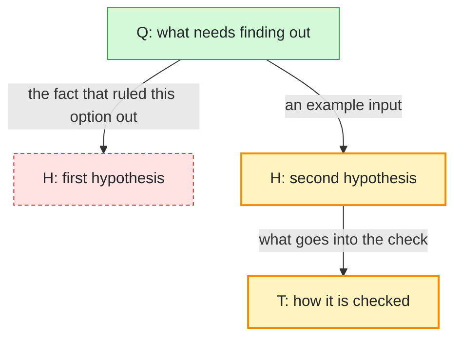

# Manual

```powershell
.\recipe.ps1 run [file] [--json]
```

| argument | what it does |
| --- | --- |
| `file` | a Markdown file, of which the first `mermaid` block is read, or a whole `.mmd` file; `.claude/decision_graph/current_task.md` by default |
| `--json` | print JSON instead of the report in Russian |

The report gives the node and edge counts, the nodes of each kind by status, the open questions, the rejected nodes and the longest chain. The chain runs only through nodes that were not rejected.

A line that cannot be parsed goes to stderr and is skipped. A file that cannot be read, a Markdown file with no `mermaid` block and a diagram that is not a flowchart stop the tool with a message and exit code 1.

## The graph format

A node's kind is the letter its label starts with, and its status is its Mermaid class.

| label starts with | kind |
| --- | --- |
| `Q:` | a question |
| `H:` | a hypothesis |
| `T:` | a check |
| `A:` | a decision |

Any other label counts as "other". The statuses are `active`, `done` and `rejected`, and a node with none of them counts as having no status.



The `classDef` lines are what colour the statuses when the graph is drawn: yellow for in progress, green for accepted, a dashed red for rejected.

- An arrow's label carries the real data that passed between the nodes: a concrete input, a result, a number. It holds no `"` and no `|`.
- A node's text is always in quotes, `["..."]`, with no `"` inside, so brackets and special characters do not break the syntax.
- A status changes by editing the one suffix on the line that defines the node. A second line with `X:::done` adds a class and does not replace the first.

All of Mermaid's node shapes and the arrows `-->`, `---`, `-.->`, `==>`, `<-->` and `--o` are read, as are chains `A --> B --> C`, groups `A & B --> C`, labels in `|"..."|` and `-- text -->`, and `class A,B status` statements.

`.claude/decision_graph/trace.md` and `archive/` are graphs from before the lab, written by a Claude Code hook that this repository no longer wires up.
